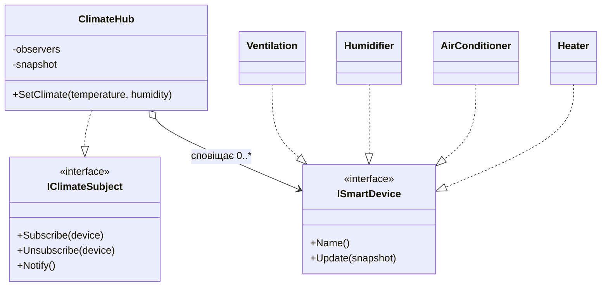

# Практична робота №2. Патерн «Спостерігач» у системі «Розумний дім»

Навчальний C++17-проєкт демонструє патерн **Observer**. Центральний кліматичний хаб зберігає температуру та вологість, а підключені смарт-пристрої автоматично реагують на кожну зміну стану.

## Що реалізовано

- `IClimateSubject` — інтерфейс суб'єкта з методами `Subscribe`, `Unsubscribe` і `Notify`.
- `ISmartDevice` — інтерфейс спостерігача з методом `Update`.
- `ClimateHub` — зберігає `ClimateSnapshot` і список підписників.
- Захист від повторної підписки одного об'єкта.
- Динамічне підключення та відключення пристроїв під час виконання програми.
- Перевірка коректності температури й вологості.
- Журнал кліматичних подій і реакцій пристроїв у консолі.

## Правила реакції

| Пристрій | Умова ввімкнення | Дія |
|---|---|---|
| Обігрівач | температура нижча за 18 °C | увімкнути нагрів |
| Кондиціонер | температура вища за 26 °C | увімкнути охолодження |
| Зволожувач | вологість нижча за 35 % | почати зволоження |
| Вентиляція | вологість вища за 70 % | посилити повітрообмін |

## Структура патерна



## Демонстраційний сценарій

1. Хаб підключає обігрівач і зволожувач.
2. При `17 °C` і `30 %` обидва пристрої переходять у стан `ON`.
3. Під час роботи програми підключається кондиціонер.
4. При `29 °C` і `50 %` кондиціонер переходить у стан `ON`.
5. Обігрівач відключається від хаба.
6. При наступній зміні клімату обігрівач більше не отримує `Update`.
7. Підключається вентиляція, яка реагує на вологість `75 %`.

## Запуск через g++

```bash
g++ -std=c++17 -Wall -Wextra -Wpedantic main.cpp -o smart-home
./smart-home
```

У Windows запустіть `smart-home.exe`.

## Запуск через CMake

```bash
cmake -S . -B build
cmake --build build
```

Linux і macOS:

```bash
./build/smart_home
```

Windows з багатоконфігураційним генератором:

```powershell
.\build\Debug\smart_home.exe
```

## Файли репозиторію

- `main.cpp` — реалізація патерна та демонстраційний сценарій.
- `CMakeLists.txt` — налаштування збірки C++17.
- `.github/workflows/build.yml` — автоматична перевірка збірки на GitHub Actions.

## Висновок

`ClimateHub` працює лише з інтерфейсом `ISmartDevice`, тому не залежить від конкретних типів пристроїв. Новий спостерігач додається без зміни хаба, а склад підписників можна змінювати під час роботи програми. Це зменшує зв'язаність класів і спрощує розширення системи.
